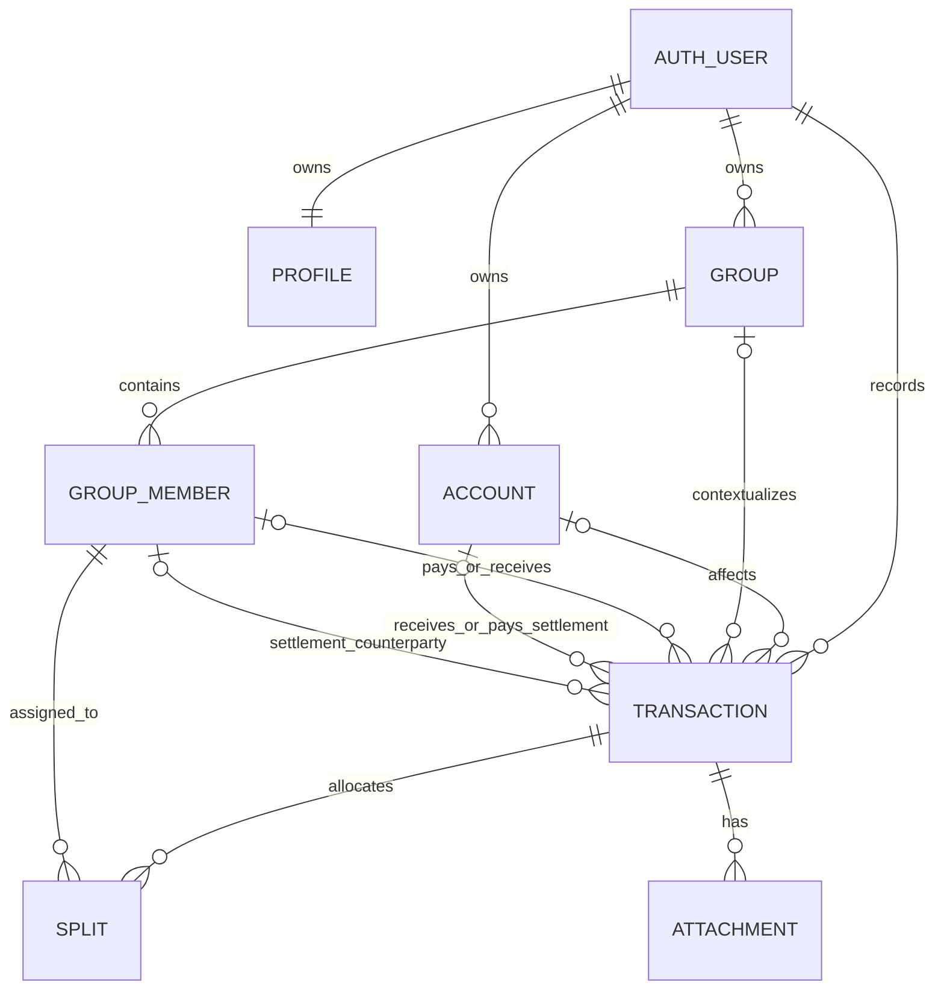

# Buddi data model proposal

Status: initial schema migration applied successfully to the local Supabase stack. A browser-local, read-only workbook preview now checks the proposed mapping, but no workbook rows have been imported and no hosted Supabase project is connected. Review the open currency, account-mapping, and duplicate-handling decisions below before enabling writes. See [SQL migration](supabase/migrations/202611080001_initial_schema.sql).

## What the reviewed exports tell us

The newly supplied 2026 workbook has 406 source rows, including personal expense/income records and 75 mirrored transfer pairs. An earlier reviewed workbook had 316 rows and 58 pairs, so counts vary by export period. The 2026 file contains USD and PEN, a native `Amount`/`Currency` pair, a separate USD-equivalent field, and a `Note` column; `Description` and `Subcategory` are often blank.

| Existing export field / pattern | Meaning for the new model |
|---|---|
| `Period` | Transaction date/time (`occurred_at`). |
| `Income/Expense = Exp.` | Personal expense, unless the row is a balance correction that needs separate treatment. |
| `Income/Expense = Income` | Personal income. |
| `Transfer-Out` + `Transfer-In` | Two mirrored account legs for one transfer. The 2026 export has 75 of each (75 pairs); the earlier export had 58 pairs. Store one canonical transfer with source and destination account IDs; create both account balance effects from that record. |
| `Accounts` and `Category` on transfer rows | The row's account and its counterpart account, rather than an expense category. Normalize these into `source_account_id` and `destination_account_id`. |
| `Category` on expense/income rows | Expense/income category. Keep category and account as separate fields. |
| `Note` | Preserve as a memo or fallback description when `Description` is blank. When both legs have a note, equal notes disambiguate same-date, same-amount transfer pairs. In the 2026 export this uniquely resolves three otherwise ambiguous pairs. |
| `Splitwise` pseudo-account | It is a clearing representation for shared balances, not a personal cash account. A transfer from a personal account to `Splitwise` with a person's name in `Note` increases the amount that person owes the owner; the reverse direction records a repayment and reduces that receivable. Store one shared-balance movement per mirrored pair. Owner mapped `Other` to Andres and identified the Walmart cashback transfer as a purchase refund. |
| Expenses recorded to `Splitwise` | Owner asked to provisionally assign these to Sam for the prototype. Preserve each full bill amount as a shared-expense draft and flag the participant split for manual adjustment; do not infer Sam's exact share from the export. |
| `Balance Update` on `Splitwise` | Owner identified the 2026 +$25.09 row as a manual shared-balance adjustment with unknown origin. Preserve its direction and reason; the shared-ledger adjustment needs a supported database transaction type before import. |
| `Amount` + `Currency` | Original amount and currency. Preserve the source values exactly. |
| `USD` | USD-equivalent snapshot. Preserve it as a historical converted value; do not recompute historical values using today's exchange rate. |
| `Balance Update` category | Owner confirmed this is an account-balance adjustment, separate from income and expense reporting. Normalize as `balance_adjustment`; preserve the source row's direction (`Income` increases the account, `Exp.` decreases it) while excluding it from income/expense totals. |
| `Splitwise` on older transfer exports | A counterpart account label. It does not identify the group, members, or each person's share by itself. The 2026 export does not contain a `Splitwise` column; its pseudo-account appears in `Accounts`, with the transfer counterpart in `Category`. |
| `Accounts.1` | A second field with a duplicate header and numeric values. Its business meaning is unclear; exclude from the canonical model until the owner explains it. |
| `Subcategory` | Empty in the reviewed export; make optional and do not require it for the MVP. |

For the 2026 workbook, date, direction, account pair, native amount, currency, and USD-equivalent values reconcile across all 75 transfer pairs. The three pairs sharing the same date and amount are distinguishable by matching `Note` values. This supports saving each transfer once and applying one debit plus one credit, subject to confirming account mappings and opening balances.

## Entity relationships

`AUTH_USER` is the single owner in the first release. A `GROUP_MEMBER` is normally just a name; its optional auth-user link stays empty until multi-user collaboration is a separate feature. The owner's allocation is represented by one `splits` row with `is_owner = true` and no `group_member_id`; `group_members` contains the named friends.

## Proposed records

### `profiles`

- `user_id` (primary key and auth identity)
- `display_name`, `locale`, `time_zone`, `default_currency`
- `onboarding_completed_at` or a small onboarding state

### `accounts`

- `id`, `owner_id`, `name`, `currency`, `opening_balance`, `is_active`
- The app calculates a current balance from the opening balance and posted account movements. It does not overwrite the opening balance when a transaction is added.

### `groups` and `group_members`

- `groups`: `id`, `owner_id`, `name`, `created_at`
- `group_members`: `id`, `group_id`, `display_name`, nullable `linked_user_id`
- The owner is represented by an explicit owner split row, allowing every shared bill to have one allocation for the owner and one for each friend.
- A group name such as the legacy `Splitwise` account must not be assumed to equal a particular trip, household, or friend group.

### `transactions`

One canonical record per event. Suggested columns:

- Identity/ownership: `id`, `owner_id`, `type` (including `balance_adjustment`), `status` (`draft` or `posted`)
- Description: `description`, `occurred_at`, optional `note`, `capture_source`
- Money: `amount`, `currency`, optional `usd_amount_snapshot`, optional `usd_rate_snapshot`
- Personal classification: optional `category_id`, optional `account_id`
- Transfers: optional `source_account_id`, `destination_account_id`
- Shared expense: optional `group_id`, `payer_member_id`, and the account used only when the owner paid
- Settlement: `type` (`settlement_received` or `settlement_paid`), optional `group_id`, `counterparty_member_id`, and `account_id`

Use an exact decimal type in the database, not binary floating point. The initial enabled currencies are USD and PEN (two decimal places). If a transfer moves value between accounts denominated in different currencies, the schema must capture the source amount/currency and destination amount/currency plus the applied rate and any fee; the current export review did not establish that rule.

### `splits`

- `transaction_id`, `group_member_id`, `share_amount`
- Shared expenses include the owner's split and the other participants' splits. The sum must equal the shared bill in its original currency, with cent rounding allocated deterministically.
- The owner's split is the personal expense amount. The group's other shares drive receivables when the owner paid.
- A shared expense is created as a draft, its split rows are added, then it is marked posted. A deferred database constraint checks one owner allocation and that all allocations sum to the bill total at commit.

### Settlement transactions

- Store settlements as rows in `transactions` with `type` set to `settlement_received` or `settlement_paid`.
- Include `group_id`, `counterparty_member_id`, and `account_id`; the shared transaction fields hold amount, currency, date, and note.
- A received settlement credits a personal account and reduces a receivable; a paid settlement debits an account and reduces a debt. Neither is categorized as new income or expense.
- Partial settlement is supported. The remaining balance is derived from shared expense obligations and settlements, rather than manually zeroed.

### `attachments`

- `id`, `owner_id`, `transaction_id`, `private_storage_path`, `mime_type`, `created_at`
- Keep receipt objects private and authorize access through the owner's session. Store AI extraction suggestions only as draft data until confirmed.

## Account and report calculations

- Personal expense: debit its selected account; add the full amount to expense reporting.
- Personal income: credit its selected account; add the full amount to income reporting.
- Purchase refund: credit the account and reduce expense reporting when matched to the original purchase; do not count the refund as ordinary income. The workbook's Walmart refund is one cent different from a same-day Walmart cashback income row, so duplicate review is required.
- Transfer: debit the source account and credit the destination account; affect neither income nor expense reporting.
- Balance adjustment: increase or decrease the selected account using the recorded direction; affect neither income nor expense reporting.
- Shared bill paid by owner: debit the selected account by the full bill; report only the owner's split as personal expense; add other participants' shares to receivables.
- Shared bill paid by someone else: no owner account movement; report the owner's split as personal expense; add the owner's amount owed to that payer.
- Received/paid settlement: post a personal account credit/debit and reduce the matching group balance; exclude it from income/expense reports.
- Balance correction: use a dedicated `balance_adjustment` type and preserve whether it increases or decreases the account. Do not classify it as income/expense.

## Security and service boundary

- Use the authenticated user ID as `owner_id` on every personal row and enforce Row Level Security on all database tables and private storage.
- Do not trust an `owner_id` supplied by the browser; derive access from the authenticated session.
- Keep the Gemini secret in a server-side function. The browser submits a deliberate capture request and receives a structured draft; only the owner's confirmation creates a posted transaction.
- Configure OTP rate limits and CAPTCHA and check SMS costs for the owner's country before live phone sign-in.

## Decisions to close before production use and any historical import

1. What is the meaning of the numeric `Accounts.1` duplicate field? Until resolved, ignore it for import.
2. Does the owner need historical group/member/split data migrated, or should the MVP start with new group records only? The reviewed export's `Splitwise` label does not contain those details.
3. Which exchange-rate source and precision should be used for new PEN-to-USD snapshots? Preserve the export's existing `USD` values during any later import.
4. Are cross-currency transfers allowed, and if so, how are both account-side amounts, rate, and fees recorded?

The owner has confirmed how `Balance Update` is classified. Its direction can be carried over from the existing `Income/Expense` field, but a later import preview should verify the resulting balances before finalizing. Other open items are schema/import decisions, not blockers for a local prototype.
