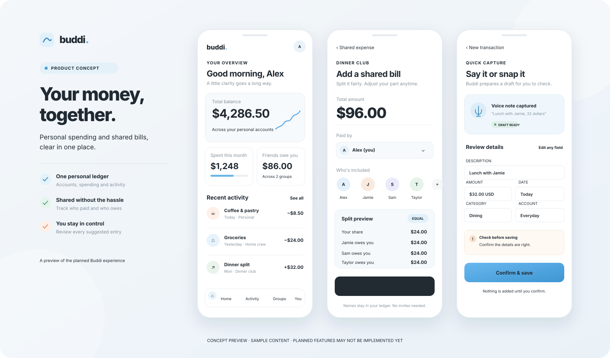

# Buddi

**Your budget, with a buddy.**

Buddi is an early-stage portfolio prototype exploring a single experience for everyday budgeting and friend-to-friend expense sharing. The goal is to make personal transactions, shared bills, and who-owes-whom balances feel like one coherent picture.

This repository contains a browser-based prototype connected to a local Supabase stack for single-owner sign-in, groups, and personal/shared expense records.

See [PRODUCT_CONTEXT.md](PRODUCT_CONTEXT.md) for the agreed first-release scope, accounting rules, and AI direction.
The confirmed MVP flows and acceptance criteria are in [MVP_SPEC.md](MVP_SPEC.md).
The proposed ledger entities and export mapping are in [DATA_MODEL.md](DATA_MODEL.md).

## Prototype features

- Overview dashboard for balances, monthly spending, categories, and recent activity
- Personal and shared expense entry
- Create reusable groups and add people without requiring them to register
- Shared account names with a default equal split and editable personal share
- Payer tracking: expenses you pay create receivables; expenses paid by someone else create an amount you owe
- Optional browser speech recognition to start filling an expense form
- Split preview that separates your personal expense from personal-account movement and group balances
- Friend balance list derived from recorded shared splits
- Searchable transaction list and mobile layout
- Installable PWA shell with a home-screen icon and cached app interface
- Email one-time-code sign-in captured locally by Mailpit
- Supabase Auth, PostgreSQL, and Row Level Security for local data persistence
- Guided first-use setup for accounts, optional groups, and a first transaction
- Personal account creation with currency and starting balance
- Account editing for name and opening balance; currency locks once an account has transaction history
- Personal income, same-currency transfers, and balance adjustments in the transaction ledger
- Partial and full shared-balance repayments, recorded against a personal account without changing expense totals
- Currency-aware balances and spending charts that keep USD and PEN separate without inventing exchange rates
- Monthly category budgets in USD or PEN with edit/delete controls and progress based on personal spending plus the owner's share of shared expenses
- Transaction search and type/currency/date filters, with CSV export of the matching rows
- Edit posted personal expenses, income, balance adjustments, and transfers; shared expenses and repayments stay locked to protect linked balances

## Run it

Start Docker Desktop and the local Supabase stack from this repository with `supabase start`. Then serve this folder on loopback port 3000 with `python -m http.server 3000 --bind 127.0.0.1` and open [http://127.0.0.1:3000](http://127.0.0.1:3000). On a supported phone browser, use its Add to Home Screen or Install option. Enter an email, open [Mailpit](http://127.0.0.1:54324), and enter the one-time code shown in the message. The Supabase JavaScript client loads from jsDelivr, so sign-in and data access need internet and a reachable Supabase server. The service worker caches the app shell; it does not queue offline changes. The app and database remain local; this does not connect a hosted Supabase project.

## Important prototype boundaries

- First-use setup creates a personal account with its currency and starting balance; if setup is skipped, Buddi creates a zero-balance `Cash` account in USD. No Excel rows are imported.
- Editing an opening balance changes the account's starting point without rewriting transactions. Budgets are monthly and category-based; cross-currency transfers remain unavailable until the exchange-rate rule is defined.
- Voice recognition support depends on the browser and permission; all fields remain editable.
- Phone OTP and hosted storage are not connected yet. Receipt images can be attached to a transaction and stored in the local private Supabase bucket. Reading a receipt sends an optimized copy to Gemini only after the user taps **Read receipt**; text and voice suggestions send the description only after the user taps **Suggest fields**. Both require a user-provided local Gemini key.
- To enable local AI drafts, copy `supabase/functions/.env.example` to `supabase/functions/.env`, add your Gemini API key, and restart the local Supabase stack. Never put the key in browser code or commit the `.env` file. Use sample descriptions and receipts while evaluating: Google's Gemini API free tier may use submitted content to improve its products.
- Settlement entries track repayments in Buddi; the app does not send messages or move money externally.

## Product direction

The intended product model keeps personal financial accounts and categories separate from the shared-expense ledger. A shared purchase is saved once, shows the owner's share in personal spending, and derives amounts owed from participant splits. If another person pays, the owner's share remains a personal expense while the amount owed to that payer is tracked separately. This local slice does not import the source workbook or connect to hosted services.

## Stack

Vanilla HTML, CSS, and JavaScript, with Supabase JS loaded from jsDelivr in the browser.
